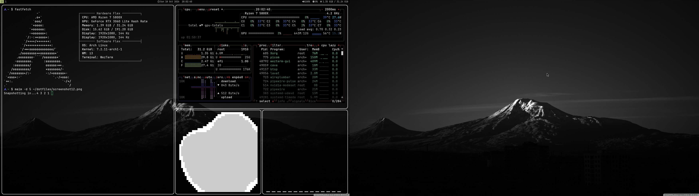

# my dotfiles :D

hi!! this is my first time posting my config on github so pls be nice lol

i use arch btw (i know, i know) with i3 and its my first rice!! it took me like a whole weekend and i broke it like 5 times but i finally got it working

## screenshot

## whats in here
- **i3** - my window manager. i changed the mod key to the windows key cuz alt was annoying
- **polybar** - the bar at the top. it has a clock with the year (so i never forget what year it is), my volume, cpu, ram and whatever music is playing. took forever to get the icons working
- **wezterm** - my terminal, its see-through!! (50% opacity) and i made a shortcut to quit really fast
- **fastfetch** - so i can flex my specs in the terminal
- **prompt** - my terminal prompt has the arch logo in it (needs a nerd font or its just a box lol). yes im that guy
- **wallpaper** - snow.jpg is in the wallpapers folder, i think it looks really clean
- **login screen** - i use the breeze sddm theme with my own wallpaper (mountain.jpg, its in the wallpapers folder too). looks so clean when u boot up

## how to use it
copy the stuff into your ~/.config folder. BACK UP YOUR OWN CONFIG FIRST i learned this the hard way lol

## known bugs
- sometimes i get like 3 polybars at once (fixed it i think??)
- some paths say /home/archix so u have to change them to ur own username
- if the icons are boxes u need a nerd font
- cmatrix is not see-through and idk why yet (still working on it)

## credits
- a LOT of googling
- the arch wiki (thx)
- claude helped me a little with some of the configs, but i did most of it myself (and i broke stuff on my own too)

## servus!! (pls read)
im 14 and from austria btw, so sorry if my english is a bit weird sometimes lol

im still learning lua and python so my configs are probably voll messy. if u have tips on how to make it better pls tell me nicely!! no mob pls, im just a beginner and this is my first time sharing stuff :)

## can u recommend me stuff?
ik its a bit weird to ask this in a dotfiles repo, but u already know im learning lua and python (see above lol). does anybody know good **books** or **courses** for beginners? best would be free ones or really cheap ones cuz im 14 and my pocket money is not that big haha. english or german both work for me!!

u can just open an issue here and write it in there, i will read everything. danke schön!!

stars are appreciated :) lg from austria 🇦🇹
